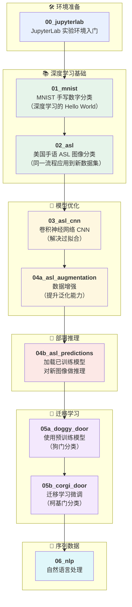

# NVIDIA DLI x ModelScope 深度学习基础

> 在 NVIDIA 深度学习培训中心（DLI）免费获取完整课程资源，灵活开启 AI 学习与实践，满足多元化培训需求。

NVIDIA 开源课程面向个人学习者、教育机构、企业及开发者社区，提供可直接获取和使用的 AI 课程内容与实验材料。通过多种课程获取与实践方式，帮助学习者更便捷地开展 AI 学习与动手实践，并进一步衔接 NVIDIA 进阶培训与认证。

在网页上阅读：[NVIDIA DLI x ModelScope 深度学习基础](https://modelscope.cn/gallery/NVIDIA_Training_and_Certification/nvidia-dli-deep-learning-zh-modelscope)

原始课程：[深度学习基础](https://github.com/NVDLI/fundamentals-of-deep-learning-zh?ncid=bn-prom-622541-modelscope) 

可选在自有 GPU 设备、NVIDIA DGX Spark、NVIDIA 合作伙伴相关设备、在线实验室和 [ModelScope Notebook](https://modelscope.cn/gallery/NVIDIA_Training_and_Certification/nvidia-dli-deep-learning-zh-modelscope) 部署和运行，可根据不同学习场景选择合适方式，更便捷地进入课程学习与实验。

## 学习成果

完成本课程的实验后，学员将能够：

- 使用 PyTorch 在真实图像数据集上构建并训练神经网络
- 将卷积神经网络（CNN）应用于图像分类任务
- 利用数据增强与迁移学习提升有限数据集上的模型精度
- 理解偏差-方差权衡，并掌握应对过拟合的技术手段
- 部署已训练的模型，对新的未见数据进行预测

## 课程模块

| # | 模块 | 幻灯片 | Notebook |
|---|---|----------|--------|
| 01 | 深度学习简介 | [slides_01.pptx](./course_content/slides/part1.pptx) | [01_mnist.ipynb](./course_content/tutorials/01_mnist.ipynb) |
| 02 | 神经网络的训练方式 | [slides_02.pptx](./course_content/slides/part2.pptx) | [02_asl.ipynb](./course_content/tutorials/02_asl.ipynb) |
| 03 | 卷积神经网络 | [slides_03.pptx](./course_content/slides/part3.pptx) | [03_asl_cnn.ipynb](./course_content/tutorials/03_asl_cnn.ipynb) |
| 04 | 数据增强与模型部署 | [slides_04.pptx](./course_content/slides/part4.pptx) | [04a_asl_augmentation.ipynb](./course_content/tutorials/04a_asl_augmentation.ipynb)   [04b_asl_predictions.ipynb](./course_content/tutorials/04b_asl_predictions.ipynb) |
| 05 | 预训练模型 | [slides_05.pptx](./course_content/slides/part5.pptx) | [05a_doggy_door.ipynb](./course_content/tutorials/05a_doggy_door.ipynb)   [05b_corgi_door.ipynb](./course_content/tutorials/05b_corgi_door.ipynb) |
| 06 | 高级架构 | [slides_06.pptx](./course_content/slides/part6.pptx) | [06_nlp.ipynb](./course_content/tutorials/06_nlp.ipynb)  |

## 在 ModelScope Notebook 中运行

1. 打开 [魔搭灵感流](https://modelscope.cn/gallery/NVIDIA_Training_and_Certification/nvidia-dli-deep-learning-zh-modelscope) 点击“运行”，选择新版 Notebook 。把项目复制到 `/mnt/workspace` 持久化存储，保留全部文件和目录结构。
2. 打开 `course_content/tutorials/` 中的课程 notebook，按 00、01、02、03、04a、04b、05a、05b、06 的顺序学习。
3. 初始化只需一行 `%cd "/mnt/workspace/Gallery: NVIDIA_Training_and_Certification_NVIDIA-DLI-Deep-Learning-ZH-ModelScope/course_content/tutorials"`，随后导入本课需要的 helper；不再自动下载项目或修改 sys.path。实际复制目录若被重命名，应同步调整该行路径。
4. 使用默认镜像预装库既可以开始运行。
5. 模型和数据首次从 modelscope.cn 下载，后续使用 `tutorial_assets/` 缓存。

原课程中的 `FIXME` / `TODO` 练习仍保留，须由学习者填写。04b 需要先完成 04a，生成 `model.pth`。`torch.compile` 默认关闭；如确需启用，设置 `DLI_USE_TORCH_COMPILE=1`。

## 使用到的学习资源

| 类型 | ModelScope 仓库 | 原来源 | 许可 |
|---|---|---|---|
| 数据集 | [AI-ModelScope/MNIST](https://modelscope.cn/datasets/AI-ModelScope/MNIST) | TorchVision OSSCI MNIST 原始 IDX | MIT |
| 数据集 | [AI-ModelScope/asl-hg](https://modelscope.cn/datasets/AI-ModelScope/asl-hg) | juanjodurillo/asl-hg；原始记录 DOI 10.17632/j4y5w2c8w9.1 | CC-BY-4.0 |
| 数据集 | [AI-ModelScope/penny-the-corgi](https://modelscope.cn/datasets/AI-ModelScope/penny-the-corgi) | Kaggle danielledetering/penny-the-corgi | CC-BY-4.0 |
| 模型 | [timm/vgg16.tv_in1k](https://modelscope.cn/models/timm/vgg16.tv_in1k) | TorchVision 原始 vgg16-397923af.pth；timm/vgg16.tv_in1k 模型卡 | BSD-3-Clause |
| 模型 | [google-bert/bert-base-cased](https://modelscope.cn/models/google-bert/bert-base-cased) | Google BERT | Apache-2.0 |
| 模型 | [google-bert/bert-large-uncased-whole-word-masking-finetuned-squad](https://modelscope.cn/models/google-bert/bert-large-uncased-whole-word-masking-finetuned-squad) | Google BERT SQuAD | Apache-2.0 |

## 许可与变更

课程资源基于 Apache License 2.0 和 CC BY 4.0 开放许可协议发布，可免费获取，并可在相应许可证允许范围内下载、修改与再分发。具体适用范围及要求以各课程 GitHub 仓库中的许可证说明为准。

第三方媒体许可见 [THIRD_PARTY_NOTICES.md](https://github.com/VoyagerXvoyagerx/nvidia-dli-deep-learning-zh-modelscope/blob/main/THIRD_PARTY_NOTICES.md)。保留 `LICENSE`、`LICENSES/` 和第三方归属说明。本版新增 ModelScope 资源 helper、简化目录初始化和最小验证 notebook；使用 ModelScope 下载模型和数据集。详见 [适配改动报告](https://github.com/VoyagerXvoyagerx/nvidia-dli-deep-learning-zh-modelscope/blob/main/ADAPTATION_REPORT.md)。

## 开源课程

[深度学习基础](https://github.com/NVDLI/fundamentals-of-deep-learning-zh?ncid=bn-prom-622541-modelscope)
[NVIDIA 开源课程目录](https://www.nvidia.cn/training/open-source/?ncid=bn-prom-460536-modelscope)

## 更多资源

- [NVIDIA 培训和认证中文官网 >](https://www.nvidia.cn/training/?ncid=bn-prom-596593-modelscope)
- [NVIDIA 认证 >](https://www.nvidia.cn/training/certification/?ncid=bn-prom-860160-modelscope)
- [在线自主培训 >](https://www.nvidia.cn/training/self-paced-courses/?ncid=bn-prom-508293-modelscope)
- [讲师指导的培训班 >](https://www.nvidia.cn/training/instructor-led-workshops/?ncid=bn-prom-315129-modelscope)

